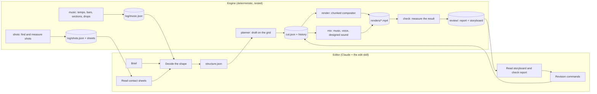

# Architecture

This document describes Workprint's design: what it has to do, how it is divided,
the data it keeps, and why the main engineering decisions were made. It was written
before the implementation and updated where building and testing changed a decision.
Those places are marked **Changed during build**.

## What the system must do

1. Take a folder of video clips, an optional music track and a written brief, and
   produce a finished film an experienced editor would accept as a useful first cut.
2. Keep the human in control: every decision is visible in a readable file, can be
   changed in plain language, and changing one thing does not disturb the rest.
3. Be honest about what it knows. Claims about footage come from looking at frames
   or measuring them, never from filenames.
4. Run on an ordinary laptop: no GPU, no cloud service, no API key, no editing
   application required. Source media is never modified.
5. Be deterministic: the same cut renders to the same pixels, so work can be cached,
   compared and reproduced.

## The division of labour

Workprint is two things with a narrow interface between them.

- **The editor** is Claude, following the `edit` skill. It reads the brief, looks at
  contact sheets, decides the shape of the film, writes a structure, reads the
  storyboard of each render, and revises. Everything that needs judgement happens here.
- **The engine** is a Python package with a command line. It measures, renders exactly
  what a cut file says, checks the result against the cut, and applies named revisions.
  Nothing in the engine calls a language model.

The interface is files on disk and command output. That keeps the engine testable
without a model in the loop, and lets a person run or edit any step by hand.

## Layers and modules

| Layer | Module | Responsibility |
|---|---|---|
| Media I/O | `ff.py` | Every call to `ffmpeg`/`ffprobe`: probing, frame pipes, audio decode, encoding, loudness, joining chunks |
| Project state | `project.py` | The project directory, source registry, content fingerprints, cut history |
| Media analysis | `shots.py`, `sheets.py`, `music.py` | Shot boundaries and per-shot measurements; contact sheets and filmstrips; tempo, beats, bars, sections, drops, key |
| Editorial planning | `planner.py`, `profile.py` | First assembly from a structure on the beat grid; style profiles measured from reference films |
| Edit representation | `manifest.py` | The cut format, validation, the chunk plan, diffs |
| Rendering | `render.py`, `look.py`, `titles.py` | Frame compositor, grade and effects, typography |
| Sound | `mix.py`, `sound.py` | The mix and master; synthesised designed sounds |
| Evaluation | `check.py` | Measures a rendered file against its cut, the music and delivery targets |
| Revision | `revise.py` | Named edits to an existing cut, each recorded in history |
| Delivery | `export.py` | EDL and OpenTimelineIO export (experimental) |
| Interface | `cli.py`, `scripts/workprint.py`, `skills/` | Command line, self-installing launcher, the Claude Code skills |

## Data

A project is a directory of plain files (see `skills/edit/reference/cut-format.md`
for every field):

- `workprint.json`: sources (id, path, content fingerprint, probed facts), music, output format.
- `log/shots.json`: one entry per detected shot: where it is in its source, measured
  motion, camera movement, exposure, where its liveliest and calmest stretches begin, and
  the editor's own description, tags and rating.
- `log/music.json`: tempo, beat times, bar lines, per-bar energy, sections, drops, accents, key.
- `cut.json`: the edit. `history/NNNN.json` + `history/index.json`: every saved version with a message.
- `cache/`: rendered chunks and mixes, keyed by content. Safe to delete.

## Decisions

### The cut is a list of slots anchored to the timeline

Each picture entry says when it *starts*; it lasts until the next one starts. The
alternative, a list of clips with durations laid end to end, is how most edit lists
work, but it is the wrong shape for cutting to music: there, the cut points belong
to the music and the footage is what gets swapped underneath them. With slots,
replacing a shot cannot move a cut, moving a cut changes exactly two slots, and
"is this cut on the beat" is a property of one number.

### Rendering is a Python compositor feeding ffmpeg, in cached chunks

Two alternatives were considered. Building one large ffmpeg filter graph per film is
fast but makes anything beyond scale, crop and fade awkward, and gives no place for
frame-level effects, mattes or tracking later. Remotion gives a rich compositing
model but brings a Node toolchain, a headless browser and a licence that requires
payment from larger companies. Workprint composites frames in NumPy/OpenCV (decode
and encode stay in ffmpeg), which is slower per frame but fully controllable and
extensible in plain Python.

The speed is recovered by never rendering the same thing twice. The film is rendered
as independent **chunks**; each is stored under a hash of everything that affects its
pixels (source fingerprint, in-point, speed, move, grade, effects, transitions,
overlapping titles, the look, output size, renderer revision). The finished film is
the chunks joined without re-encoding. A revision re-renders only chunks whose hash
changed, and untouched picture is bit-identical between versions, which the test
suite verifies frame by frame.

Chunk boundaries follow cut points: a slot of twelve frames or more is its own
chunk, and a run of shorter slots (rapid cutting) shares one. Grouping depends only
on each slot's own length, so editing one part of the film never regroups another.

### Analysis is implemented directly, with standard methods

Shot detection (adaptive threshold on a luma/chroma histogram distance) and music
analysis (spectral-flux onsets, autocorrelation tempo, dynamic-programming beat
tracking) are textbook techniques. Mature libraries exist for both (PySceneDetect,
librosa). They were evaluated and not made dependencies: both needs are small, the
analysis pass has to produce several other per-frame measurements in the same decode
anyway, and librosa brings a JIT compiler stack that is the most common source of
install failures on new Python versions. The beat tracker is cross-checked against a
track with a known grid in development and against a synthetic click track in the tests.

**Changed during build.** The first detector used a hue/saturation histogram. On real
night footage it split one continuous shot into dozens: hue is undefined for near-black
pixels, so sensor noise moved them between bins. It now uses a luma/chroma histogram
with an odd number of chroma bins, and requires a minimum pixel change. The same
footage now yields no false cuts.

### Colour is converted explicitly

Decoding and encoding name their matrix (BT.709 for HD) and use swscale's accurate
rounding. **Changed during build:** a test that sends a flat colour through the whole
pipeline found the default conversion path shifting greys by two code values per pass.
With accurate rounding the round trip is within one code value.

### Sound effects are synthesised, not sampled

The kit of impacts, risers and whooshes is generated from oscillators and filtered
noise. That keeps third-party audio out of the repository, makes every sound
deterministic and cacheable, and lets low elements be tuned to the key the music
analysis reports. Editors with their own sound library can use files instead.

### The planner is a helper, and says so

`draft` turns a structure into a cut by scoring logged shots against each slot
(liveliness against section energy, the editor's rating and tags, penalties for
reuse and for adjacent shots from the same source) and writes its reason on every
entry. It guarantees the mechanical things (cuts on the grid, no slot crossing a
source's own cut, no accidental reuse). It does not know whether a shot is good;
that comes from the ratings the editor recorded after looking, and from revision.

### Evaluation measures the file, not the plan

`check` decodes the rendered film and re-detects its cuts. A planned hard cut that
does not appear, or a picture change that was not planned, is reported; the second
is how a source clip's own cut hiding inside a slot gets caught. It also measures cut
points against the beat grid, loudness and true peak, black and frozen picture, title
safe areas, and reuse of footage. It reports facts and cannot judge taste.

### Installation leaves the user's Python alone

A Claude Code plugin cannot assume any Python packages. `scripts/workprint.py` uses
only the standard library, creates a private virtual environment under `~/.workprint`
on first run, installs four packages into it, and runs the engine from the plugin's
own source tree, so a plugin update takes effect without reinstalling. FFmpeg is the
one external requirement; `doctor` detects it and prints the install command for the
user's system. The plugin deliberately has no top-level `bin/` directory, because
Claude Code's documentation states that claude.ai and Cowork do not install plugins that have one.

### Speech is measured first and recognised only on request

`voice.py` finds phrases and pauses itself, from the speech-band level of the recording,
because that is all a picture editor needs to cut on the breath and it needs no model.
Words are a different matter: timing them well needs an acoustic model. Rather than ship
or silently fetch one, the model is an explicit, checksum-pinned, optional install, and
recognition (text) is separated from alignment (time): the recogniser's words are re-timed
by a forced aligner and the finer time is kept only where the two agree. Every reading
records how its word times were obtained and whether they are estimates.

### Captions are cues in the cut, drawn once and uncovered

A caption is data in the cut like a title or a sound, so it has history, diff and undo.
Each line is rasterised once; building it word by word uncovers columns of that one
image, so text cannot shift as it appears. A chunk's cache key includes only the cues
that overlap it, and a cut with no captions hashes exactly as it did in 0.1.

### A version is the same cut at another frame size

A 9:16 film is not a second edit. `render --aspect` runs the same slots through the same
renderer with a different frame size and a per-slot focus, into its own cache entries.
`versions.py` proposes each focus from where detail and movement are; it does not
recognise subjects, and says so.

### Later additions keep older cuts' renders valid

Every 0.2 and 0.3 feature enters a chunk's cache key only when a cut uses it. A cut made
with 0.1 hashes to the same chunks today, which is checked against the example project.
New behaviour that changes pixels is opt-in per slot (`interp`, `ramp`, `intercut`,
`behind`) and never a changed default.

### Sound decisions are measured because the editor cannot hear

The mixer reports how far the voice sits above the music in the speech band while someone
is speaking, and the checker warns below about 6 dB. Treatments are fixed, documented
signal chains (`vox.py`), not learned models, so the same cut always sounds the same.

## Provenance

| Subsystem | Status |
|---|---|
| Project state, cut format, validation, chunk planning, history | Independently implemented by Motion & Matter |
| Compositor, grade, effects, transitions, typography layout, render cache | Independently implemented; uses OpenCV, NumPy and Pillow as libraries |
| Shot detection and shot measurements | Independently implemented from standard methods |
| Tempo, beat, bar, section, drop and key analysis | Independently implemented from published methods (cited in `music.py`) |
| Planner, style profiles, revision operations, evaluation | Independently implemented |
| Designed sounds, mixer, limiter | Independently implemented; uses SciPy filters |
| Decode, encode, resampling, loudness metering | Integration: runs the user's FFmpeg as a subprocess |
| `.otio` export | Integration: OpenTimelineIO's public API (optional) |
| Bundled typefaces | Third-party, unmodified, SIL Open Font License (see `THIRD_PARTY.md`) |

No source code, prompts, skill text or configuration from another project is included.

## Extending it

- **New effect:** add a branch in `look.apply_fx` and its name to `manifest.FX_NAMES`;
  bump `render.RENDER_REV` if it changes existing pixels.
- **Mattes and tracking** (SAM 2 and similar): a matte is one more input to a slot,
  cached by source fingerprint and prompt; the compositor already works per frame.
- **Other analyses** (speech, stems): add a module that writes into `log/`, expose it
  as a command, teach the skill when to use it. Heavy models stay optional extras.
