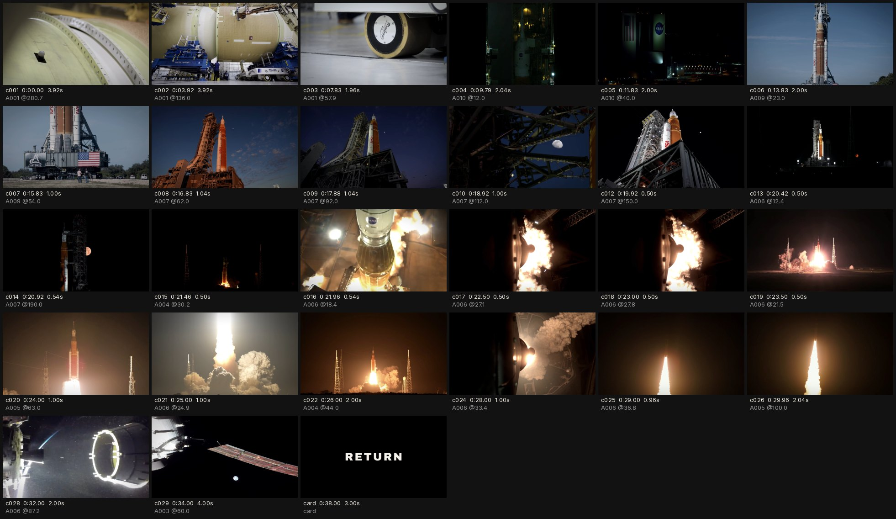

# Workprint

**A cutting room for Claude Code.** Give Claude a folder of footage, a music track and a
brief; get back a finished film cut to the music, and an edit you can keep directing
in plain language. Changing one shot re-renders half a second of picture, not the film.

Workprint is for editors, filmmakers and creative directors who already know what a
good cut is and want the distance between an idea and a watchable first cut to be
minutes. It is not a template engine, a podcast clipper or a caption tool.

By [Motion & Matter](https://ryanmchargue.com/creative), an experimental creative lab. Version 0.1.0.



*"Return", 41 seconds, cut with Workprint from NASA's public-domain Artemis footage.
Preview: [`examples/return/return-preview.mp4`](examples/return/return-preview.mp4).
How it was made, shot by shot: [`examples/return/`](examples/return/).*

## What it does

- **Looks at the footage.** Finds every shot inside every clip, measures motion, camera
  movement and exposure, and lays the shots out on contact sheets. Claude reads the
  sheets and logs what is actually in each shot before anything is cut.
- **Reads the music.** Tempo, beats, bar lines, how energy moves through the track, where it drops.
- **Cuts on the grid.** Claude decides the shape of the film; Workprint lays the cuts on
  the beat, fills each slot with the best-fitting logged shot, and writes down why.
- **Renders the film**: reframing, push-ins, speed ramps, grade, a film-wide look,
  title cards, a mix with music, voice and designed sound, mastered to a loudness target.
- **Checks its own work.** Re-detects the cuts in the rendered file, measures each one
  against the beat, measures loudness, and catches a source clip's own cut hiding inside a shot.
- **Revises in place.** "Replace the third shot", "that cut is late", "hold the ending
  longer" become named operations on a readable cut file with full history. Only what
  changed is rendered again, and untouched picture is identical to the frame.
- **Learns habits, not taste.** Point it at films you like and it measures shot lengths,
  cutting rate, how often cuts land on the beat, loudness. You correct the numbers; it uses them.

It runs on your machine. No GPU, no API keys, no accounts, no editing application.

## Install

You need [Claude Code](https://claude.com/claude-code), Python 3.10 or newer, and FFmpeg.

In Claude Code:

```
/plugin marketplace add ryrytheengineer/workprint
/plugin install workprint@motion-and-matter
```

Then ask Claude to "set up Workprint", or run `/workprint:setup`. The first run builds a private Python
environment in `~/.workprint` (four packages, about 360 MB) and tells you how to install
FFmpeg if it is missing (`brew install ffmpeg`, `winget install Gyan.FFmpeg`, `sudo apt install ffmpeg`).

Without Claude Code, from a checkout:

```
python3 scripts/workprint.py doctor        # same launcher the plugin uses
# or: pip install -e . && workprint doctor
```

## Your first film

Tell Claude what you want:

> Use Workprint. The clips are in `~/footage/robot-shoot`, the track is `~/music/pulse.mp3`.
> Cut a 45-second film: dark, industrial, aggressive. Begin quietly, build tension through
> deliberate shot selection, and land the reveal on the drop. Minimal typography, no generic transitions.

Claude sets up a project, looks at every shot, reads the music, proposes a shape, cuts,
renders a proxy, checks it, looks at the storyboard, revises, and hands you the film.
Then you direct:

> The intro feels rushed. Replace the third shot with something wider. Move the reveal one bar later.

The same steps by hand:

```
workprint init film --footage ~/footage/robot-shoot --music ~/music/pulse.mp3 --brief "..."
workprint -p film ingest                  # shots, measurements, contact sheets
workprint -p film music                   # tempo, bars, sections, drops
workprint -p film draft structure.json    # first assembly on the grid
workprint -p film render --proxy && workprint -p film check
workprint -p film replace c003 --shot A004-07
workprint -p film render && workprint -p film check
workprint -p film export --edl film.edl   # optional hand-off to an editing application
```

(`workprint` here is `python3 scripts/workprint.py`, or the installed command.)

## How it works

Claude is the editor; Workprint is the cutting room. All judgement stays with the
editor and the person directing it. The engine is deterministic Python with no model
calls: it measures, renders exactly what the cut file says, and checks the result.

The edit is one readable JSON file of *slots*: each entry says when it starts and what
fills the frame until the next one starts. Cut points therefore belong to the timeline
and the music; replacing footage never moves a cut. The film renders as independent
chunks stored by content hash, and is assembled without re-encoding, which is why a
small change costs a small render.

More: [ARCHITECTURE.md](ARCHITECTURE.md), the file formats in
[`skills/edit/reference/cut-format.md`](skills/edit/reference/cut-format.md), the
revision commands in [`skills/edit/reference/revisions.md`](skills/edit/reference/revisions.md).

## What has been tested

Measured on one Linux machine with 2 CPU cores; details and method in
[research/06-measurements.md](research/06-measurements.md).

| | |
|---|---|
| Test suite | 23 tests on synthetic media with exact expected answers, all passing |
| Example film | 11 clips (30 minutes of 1080p footage) to a checked 41 s film, end to end |
| Shot logging | 146 shots found in 30 minutes of footage, 4 to 6 times faster than real time |
| Render | 1080p at about 16 frames per second, 960x540 proxy at 23 to 30, 341 MB peak memory |
| A one-shot revision | 12 of 984 frames re-rendered in 2.5 s; the other 972 bit-identical |
| Music sync on the example | 26 of 26 cuts within 45 ms of a beat |
| Plugin | Validates, installs and loads with Claude Code 2.1.328 from a local checkout |

## Limitations

Read these before relying on it.

- **Verified on Linux only.** It is written to be portable, but it has not been run on
  macOS or Windows yet.
- **The editor cannot watch or listen.** Claude judges from still frames, filmstrips and
  meters. Motion, performance and the feel of the mix need your eyes and ears.
- **Built for music-driven films up to a minute or two.** There is no transcription, so
  dialogue and interview material are out of scope for now.
- **The first assembly is a starting point.** On the example about two thirds of its
  shots were replaced before the film was right.
- **Bar lines are an estimate.** Tempo and beats are reliable on steady music; which beat
  is "one" is a heuristic with a reported confidence. Music with a changing tempo is not handled.
- **Hard cuts inside source clips are found; dissolves are not.**
- **8-bit, Rec.709.** HDR and log footage is not converted. Slow motion repeats frames (no interpolation).
- **Timeline export is experimental.** EDL and OpenTimelineIO files are written and the
  OTIO file reads back, but import into Premiere Pro and Resolve has not been verified.
  Grades, effects, titles and the mix do not travel.
- **Designed sounds are synthesised.** They are tuned to the track's key and mixed
  conservatively, and they are not a sound library. Use your own files where it matters.
- **No mattes, tracking or object removal yet.** See [ROADMAP.md](ROADMAP.md).

## Platforms and requirements

| | |
|---|---|
| Python | 3.10 or newer |
| FFmpeg | Any recent build with libx264 and AAC (tested with 6.1) |
| Python packages | NumPy, SciPy, OpenCV (headless), Pillow; installed automatically into a private environment |
| Hardware | No GPU. The example rendered at 1080p on 2 CPU cores, peaking at 341 MB in the largest process |
| Operating systems | Linux tested. macOS and Windows expected to work, not yet verified |

## Your footage, and other people's

Workprint never modifies or uploads source media; it reads files where they are and
writes only inside the project directory. What you may do with a film depends on your
rights to the footage and music in it. The example uses public-domain and Creative
Commons material, credited in [`examples/return/SOURCES.json`](examples/return/SOURCES.json).

## Project

- [ARCHITECTURE.md](ARCHITECTURE.md): the design and the reasons for it
- [research/](research/): what was studied, what was chosen, what was measured
- [THIRD_PARTY.md](THIRD_PARTY.md): every dependency and bundled asset, with licences
- [ROADMAP.md](ROADMAP.md): what comes next
- [CHANGELOG.md](CHANGELOG.md)

Licensed under [Apache-2.0](LICENSE). The bundled typefaces are under the SIL Open Font License.

Workprint is original software. It integrates FFmpeg, NumPy, SciPy, OpenCV and Pillow
through their public interfaces and contains no code from other editing projects.
The human brings the taste; Workprint does the cutting-room work.
