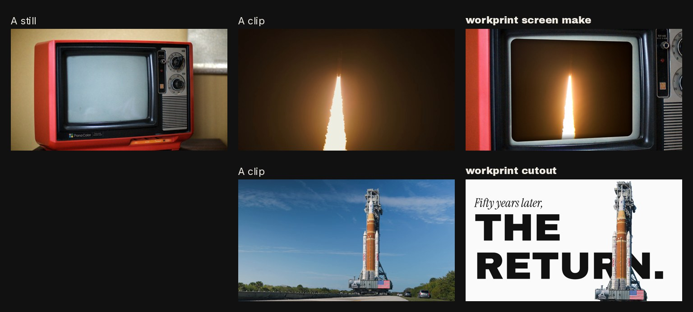

# Made frames

Two shots built with Workprint 0.6 from public material, with nothing else added: a clip
played on a television in a photograph, and a subject cut out onto a card with type behind it.
The preview is the two shots back to back with music, 6.5 s. No sound design was added.



Preview: [`made-frames.mp4`](made-frames.mp4)

## The commands

```
workprint init proj --footage WP_launch_cu_tracking.webm WP_pad39b_broll.webm WP_rollout_a2_39b.webm \
  --music WP_mus_stormfront.mp3 --size 1920x1080 --fps 24
workprint -p proj ingest

# 1. Find the screen. The guess was right on this photo; look at proj/review/screen-*.jpg first.
workprint -p proj screen find panacolor.jpg
workprint -p proj screen make panacolor.jpg --corners "1116,762 2567,801 2567,1924 1129,1996" \
  --clip A001 --in 98.0 --dur 3.5 --push 1.0,1.7 --name tv

# 2. A cut-out card (needs `workprint matte setup --yes`).
workprint -p proj cutout --clip A003 --in 12.0 --dur 3.0 --small "Fifty years later," \
  --big "THE|RETURN." --times 0.15,0.35,0.6,1.0,1.45 --place right --name card
```

On two CPU cores the screen shot took 49 s to make and the card 2 min (about 1.7 s a frame).

## What to look at

- The picture is bent to the glass, rounded at the corners, and lights the inside of the bezel.
  The camera push softens the casing at the end, because the photo is enlarged.
- On the card the rocket and its crawler come out cleanly; the tower behind the rocket comes
  with it, because the matte finds "the subject" and the tower touches the rocket.

The cut-out model's own licence terms are unresolved: see [THIRD_PARTY.md](../../THIRD_PARTY.md).
This example is for showing the feature, not a statement that the model may be used commercially.

## Sources

Credited in [`SOURCES.json`](SOURCES.json). The television photo is by mxmstryo, CC BY 2.0; the
footage is NASA's and in the public domain; the music is Kevin MacLeod's, CC BY 3.0.
None of the source files ships with the repository.
