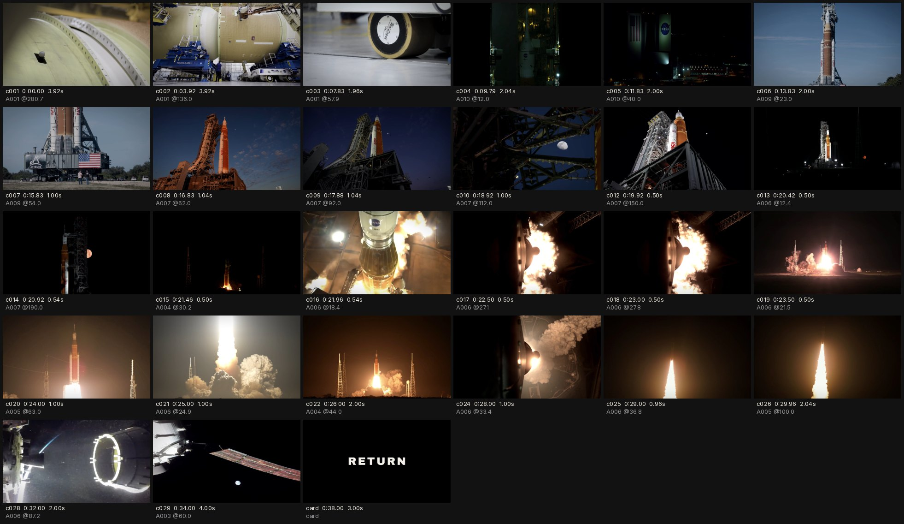

# Return

A 41-second film cut with Workprint 0.1.0 from NASA's Artemis footage.
Watch the half-size preview: [`return-preview.mp4`](return-preview.mp4).

## The brief

> Create a 40-second cinematic film about going back to the Moon, from NASA's Artemis footage.
> Dark, industrial and heavy rather than triumphant. Begin quietly inside the machine: still,
> patient shots of hardware. Build tension through the rollout to the pad with deliberate,
> accelerating cuts. Deliver the launch exactly on the music's drop, then let it breathe in
> space. Minimal typography, no generic transitions.

## What is in this folder

| File | What it is |
|---|---|
| `brief.md` | The brief, verbatim |
| `workprint.json` | The project: 11 source clips and the music, with content fingerprints |
| `log/shots.json` | The shot log: 146 shots found and measured, with the editor's description, tags and rating for each |
| `log/music.json` | The music analysis: 120 BPM, bar lines, sections, the drop at 207.99 s |
| `notes.json` | The editor's notes as applied with `workprint log apply` |
| `structure.json` | The shape of the film handed to `workprint draft` |
| `history/0003-first-assembly.json` | What the planner produced from that structure |
| `review/storyboard-first-assembly.jpg` | The first assembly on one page |
| `cut.json` | The final cut |
| `history/index.json` | Every saved version with its message: the record of how the cut changed |
| `review/storyboard.jpg`, `review/report.json` | The final film on one page, and the checker's report on it |
| `return.edl` | The cut as a CMX3600 EDL (experimental export) |
| `SOURCES.json` | Where every source file came from, its author and licence |

## The shape

| Film time | Music | What happens | Cutting |
|---|---|---|---|
| 0:00 to 0:08 | The track's quietest bars | Inside the factory: a single alignment pin, then the whole stage, held | Two four-second shots with a slow push |
| 0:08 to 0:16 | Low, building | A wheel starts to turn; the stack in the open door at night; the building from the air; morning on the crawlerway | One cut per bar |
| 0:16 to 0:22 | Building | The pad from last light to night; the Moon through the tower; a red Moon behind the stack; the first glow | One second, then half a second |
| 0:22 | **The drop** | Fire erupts around the core stage | The cut lands on the bar line |
| 0:22 to 0:32 | Full | Engine bells, liftoff, a slow-motion rise ramped up to speed, the plume going into the dark | Half a second, then one, then two |
| 0:32 to 0:38 | Eased down under the picture | The spent stage falls away; Earth rises beyond a solar array | Two seconds, then four with a slow push |
| 0:38 to 0:41 | Falls away | RETURN | Card |

## What the checker measured

PASS. 26 of 26 cuts within 45 ms of a beat and 16 on a bar line; -14.7 LUFS integrated with a true
peak of -1.1 dBTP; no unplanned picture changes, no black or frozen picture. Five cuts between two
dark shots are reported as barely visible, which is accurate and intended.

## What the editor would still change

Written by the editor (Claude) from the storyboard, without having watched or heard the film:

- The two daylight rollout shots (0:14 to 0:17) are still the brightest thing in a dark film even
  after grading. A dusk or night rollout shot would sit better if one existed in the footage.
- The factory footage is high-key and colourful by nature. It is pulled down and desaturated, but
  "dark and industrial" is only partly met in the first eight seconds.
- The half second before the drop is nearly black by design. Whether that reads as a held breath or
  as a hole depends on how the music feels there, which could not be judged here.
- The designed sounds (a riser into the drop, an impact on it, a boom on the card) were placed and
  levelled by measurement only.

## Reproducing it

1. Download the files listed in `SOURCES.json` into `footage/` under the names given
   (the source footage is not redistributed here).
2. `workprint -p examples/return render` then `workprint -p examples/return check`.

Workprint identifies sources by a content fingerprint, so a render from different encodes of the
same videos will work but will not be bit-identical to the preview.

## Credits

Footage: NASA (Kennedy Space Center, Johnson Space Center, Marshall Space Flight Center, Michoud
Assembly Facility), public domain, retrieved from Wikimedia Commons. Use of NASA material does not
imply NASA's endorsement.

Music: "Stormfront" by Kevin MacLeod (incompetech.com), licensed under
[Creative Commons Attribution 3.0](https://creativecommons.org/licenses/by/3.0/).

Full list with links: [`SOURCES.json`](SOURCES.json).
